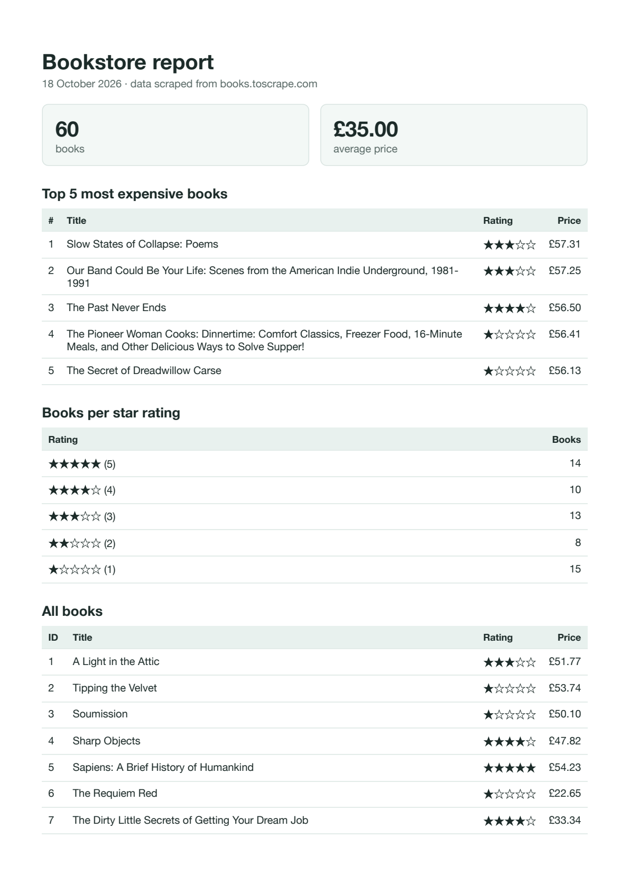

# PDF report generator

A small FastAPI service that turns a SQLite table of books into a real PDF report and hands it out by link:
**query → render → store → serve**. One SQL query set turns 60 rows into a handful of numbers, an HTML
template turns the numbers into a page, and headless Chromium (Playwright) prints the page to an A4 PDF.

FlyRank AI Internship, Backend AI Engineering track, Week 7: BE-08 "PDF report generator" (A8 in the brief).



## Dataset: the bookstore (Option B)

The 60 book records I scraped from [books.toscrape.com](https://books.toscrape.com/) in A9, The polite
scraper ([repo](https://github.com/AnasAbdelmotelb/polite-scraper)), copied unchanged into
`data/books.json`. The seed script maps the scraper's fields onto the brief's `books` table:
`price_gbp` → `price`, `rating_text` ("Three") → `rating` (3), `product_url` → `url`.

## Run it

Requires Python 3.10+.

```bash
python3 -m venv .venv
source .venv/bin/activate
pip install -r requirements.txt
playwright install chromium        # one-time browser download for PDF printing
python -m scripts.seed             # creates report.db with the 60 books (safe to run again)
uvicorn app.main:app --port 8000   # API on http://localhost:8000
```

Then, in a second terminal:

```bash
curl -X POST http://localhost:8000/reports              # → {"id":1,"file":"/reports/1/file"}
curl -o my-report.pdf http://localhost:8000/reports/1/file
```

Optional: `python -m scripts.print_report` prints the report data as JSON, and
`python -m scripts.render_test` writes `reports/test.pdf` without the API.

## API

| Method and path | What it does | Answers |
|---|---|---|
| `GET /health` | Health check | `200 {"status": "ok"}` |
| `POST /reports` | Runs the pipeline: query, render `reports/<id>.pdf`, record it. Once per day: if today's report exists, returns it instead. Body `{"force": true}` makes a new one anyway | `201` new report · `200` today's existing report · `{"id", "file"}` |
| `GET /reports/{id}` | The report record with its file link | `200` · `404` unknown id |
| `GET /reports/{id}/file` | The PDF itself, streamed from disk | `200 application/pdf` · `404` |

Store and link: only `/file` moves the PDF's bytes; every other response is a few bytes of JSON. The
PDF stays on disk in `reports/` and the database stores its path.

## The aggregation SQL

These four queries (in `app/report_data.py`) feed the report:

```sql
-- Total number of books
SELECT COUNT(*) AS total_books FROM books;

-- Average price
SELECT ROUND(AVG(price), 2) AS average_price FROM books;

-- Top 5 most expensive books
SELECT title, price, rating
FROM books
ORDER BY price DESC, title
LIMIT 5;

-- Number of books per star rating
SELECT rating, COUNT(*) AS books
FROM books
GROUP BY rating
ORDER BY rating DESC;
```

The report also lists all 60 books (`SELECT id, title, price, rating FROM books ORDER BY id`) in a long
table at the end, so the PDF runs to 3 pages.

## Proof: POST → download

A fresh run on 18 October 2026, from an empty `report.db` and `reports/` folder:

```text
$ python -m scripts.seed
Seeded 60 books into report.db

$ python -m scripts.seed   # again: still one clean copy
Seeded 60 books into report.db

$ sqlite3 report.db "SELECT COUNT(*) FROM books"
60

$ time curl -i -X POST http://localhost:8000/reports
HTTP/1.1 201 Created
content-length: 33
content-type: application/json

{"id":1,"file":"/reports/1/file"}

real	0m1.500s

$ curl -i -X POST http://localhost:8000/reports   # second click, same day
HTTP/1.1 200 OK
content-length: 33
content-type: application/json

{"id":1,"file":"/reports/1/file"}

$ ls reports/
1.pdf

$ curl -i http://localhost:8000/reports/1
HTTP/1.1 200 OK
content-length: 97
content-type: application/json

{"id":1,"created_at":"2026-10-18T03:56:44+03:00","path":"reports/1.pdf","file":"/reports/1/file"}

$ curl -o my-report.pdf http://localhost:8000/reports/1/file
HTTP 200 · 46268 bytes · application/pdf
my-report.pdf: PDF document, version 1.4, 3 pages

$ curl -s -X POST http://localhost:8000/reports -H 'Content-Type: application/json' -d '{"force": true}'
{"id":2,"file":"/reports/2/file"} HTTP 201

$ ls reports/
1.pdf
2.pdf

$ curl -i http://localhost:8000/reports/999
HTTP/1.1 404 Not Found
{"detail":"Report not found"}
```

## Stage 4: the wait

On my machine, generating the report took around 1.3–1.5 seconds in the measured runs. If report generation started taking several seconds, or several users needed reports at the same time, I would move the rendering to a background job. The API could return a report ID straight away, and the PDF would be available once the job finished.

## Stage 5: ask twice, get one

The once-per-day check protects against creating duplicate reports when a request is repeated. Without this check, a real system could accidentally send the same invoice twice or charge a customer twice for one order.

### How the check holds up under simultaneous requests

The check and the generation run in one write-locked SQLite
transaction (`BEGIN IMMEDIATE`), so a second request waits for the first and then finds its report. A
partial unique index (`report_date` where `forced = 0`) makes the database itself refuse a second normal
report for the same day. The day is the server's local date.

## Page breaks

The PDF uses print CSS so tables print cleanly: `thead { display: table-header-group; }` repeats the
header row on every page, and `tr { break-inside: avoid; }` keeps each row whole. In my tests with the
Chromium that Playwright installs (version 156), rows were not sliced even without these rules, and the
header already repeated; I kept the rules explicit so the PDF does not depend on that browser default.

## Tests

```bash
pip install -r requirements-dev.txt
pytest
```

29 tests, using a temporary database and reports folder (never your `report.db`):
- the seed (run twice → 60 rows);
- the aggregation numbers, checked against a calculation in plain Python from `books.json`;
- the HTML (escaping, print CSS) and a real PDF render of 2+ pages;
- the endpoints and 404s;
- a failed render leaving no row or file;
- the once-per-day rule, including two simultaneous requests and `force`.

## Project structure

```text
app/
├── main.py          # FastAPI endpoints
├── db.py            # SQLite connection, schema, transaction helper
├── report_data.py   # the aggregation queries
├── render.py        # HTML template + Playwright PDF printing
└── reports.py       # the pipeline: query → render → store, once per day
scripts/
├── seed.py          # fills report.db from data/books.json
├── print_report.py  # prints the report data as JSON
└── render_test.py   # writes reports/test.pdf
data/books.json      # the A9 dataset
docs/                # README screenshot
tests/
```

`report.db` and `reports/` are generated, so they are gitignored; the seed script is their recipe.

## Notes

- Built with Claude Code as an AI pair programmer, one stage at a time; I reviewed and approved each
  stage before it was committed.
- The optional Stage 7 ("AI rematch") is not included: comparing an AI's version against a hand-built
  one would not be meaningful here, because this version was itself built with AI assistance.
